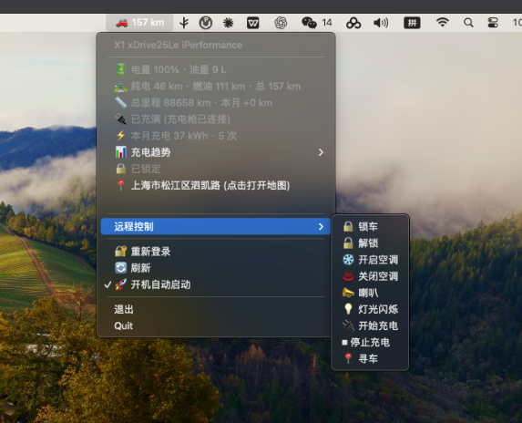
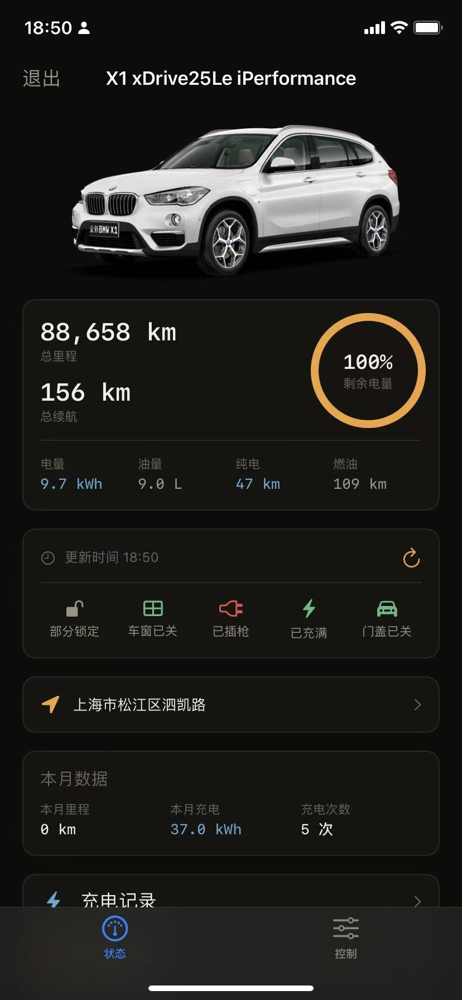

# Bimmer

macOS 菜单栏 App，对接宝马中国区互联驾驶（myprofile.bmw.com.cn），替代手机上的「Bimmer 控制器」，用于查看车辆状态与远程控制。

- 车况读取 + 远程控制（锁车 / 解锁 / 空调 / 喇叭 / 灯光 / 充电 / 寻车）
- 短信验证码登录（App 内置交互窗口，滑块自动解）
- 逆地理编码显示车辆位置，点击跳转 Apple 地图
- 本地月度里程 / 充电趋势统计
- 开机自动启动（LaunchAgent）

## 使用

安装与使用说明见 [使用文档.md](docs/使用文档.md)。

## 构建

```bash
# 本地运行
python3 -m venv venv && source venv/bin/activate
pip install -r requirements.txt
pip install -e .          # 以可编辑方式安装 bimmer 包(src 布局)
python -m bimmer

# 打包成 .app + .dmg（x86_64 机器）
pyinstaller --clean --noconfirm packaging/Bimmer.spec

# Apple Silicon 机器构建 arm64 原生包
./packaging/build_arm64.sh
```

## 目录结构

```
src/          应用源码（bimmer 包，src 布局）
packaging/    PyInstaller 打包资产（Bimmer.spec / 图标 / 构建脚本）
config/       运行时配置（config.json 源码运行用；config.example.json 为提交的模板）
docs/         使用文档 + 截图（img/）
tests/        冒烟测试
ios/          iOS 原生 SwiftUI App（project.yml 生成 Xcode 工程 / Bimmer 源码 / build.sh / install.sh）
```

## 说明

- 运行时配置 `config.json` **不会**提交到仓库：源码运行读 `config/config.json`，打包后的 App 读 `~/bimmer/config.json`；仓库只提交模板 [config/config.example.json](config/config.example.json)（含真实地图 AK 的 `config/config.json` 已被 `.gitignore` 排除）。
- 登录 token（`~/bimmer/tokens.json`）同样不提交，需登录后自动生成或从已登录机器复制。
- 远程指令会真实作用于车辆，请谨慎使用。

## 截图



